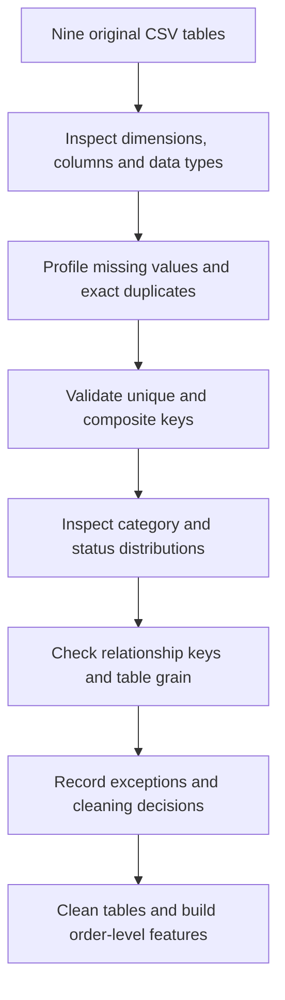

# E-Commerce Anomaly Agent

An end-to-end e-commerce analytics project built around the **Olist Brazilian E-Commerce Public Dataset**. The project combines sales analytics, daily anomaly detection, anomaly investigation, customer segmentation, and an exploratory churn-model evaluation. A Streamlit dashboard provides a starting point for reviewing flagged sales days and investigating category and seller contributions.

> **Project status:** Core analysis code and selected processed outputs are in the repository. The dashboard is an early working interface, not a production monitoring service. Notebooks 04–07 currently exist as empty placeholders; the corresponding analysis outputs were generated separately and are included where listed below. The project does not yet use a large language model to generate explanations, and anomaly flags are not proof of fraud or business causation.

## Contents

- [What it does](#what-it-does)
- [Dataset](#dataset)
- [Repository structure](#repository-structure)
- [Key analytical results](#key-analytical-results)
- [Methods and caveats](#methods-and-caveats)
- [Setup](#setup)
- [Running the project](#running-the-project)
- [Generated outputs](#generated-outputs)
- [Limitations and next steps](#limitations-and-next-steps)

## What it does

- **Data quality and preparation:** inspect the source tables, standardize date and numeric fields, and prepare cleaned datasets.
- **Sales analytics:** calculate daily and monthly product-revenue and order metrics.
- **Anomaly detection:** use Isolation Forest to flag unusual daily sales activity and rank candidate dates for review.
- **Anomaly investigation:** compare an anomaly date with a preceding baseline and examine category- and seller-level contributions.
- **Customer analytics:** build Recency, Frequency, and Monetary (RFM) segments.
- **Churn-model experiment:** evaluate a simple logistic-regression baseline for a retrospective 90-day inactivity label.
- **Dashboard:** inspect prioritized anomaly records, review available investigation summaries, and explore monthly revenue in Streamlit.

## Dataset

The project uses the [Olist Brazilian E-Commerce Public Dataset on Kaggle](https://www.kaggle.com/datasets/olistbr/brazilian-ecommerce). It contains related tables for orders, order items, payments, customers, products, sellers, reviews, product-category translations, and geolocation.

The raw data is **not committed** to this repository. Download it from the dataset source and place the CSV files in `data/raw/`. Keep the original filenames, such as `olist_orders_dataset.csv`, `olist_order_items_dataset.csv`, `olist_order_payments_dataset.csv`, `olist_customers_dataset.csv`, `olist_products_dataset.csv`, `olist_sellers_dataset.csv`, `olist_order_reviews_dataset.csv`, `product_category_name_translation.csv`, and `olist_geolocation_dataset.csv`.

The project’s `.gitignore` excludes `data/raw/` and selected large derived CSVs to keep the Git repository smaller. The data remains your responsibility to download locally before rerunning the full pipeline.

## Raw-data EDA: findings from the original CSVs

This section documents the exploration of the original Olist CSVs before cleaning and feature aggregation. These counts are from the raw-data EDA notebook; they are distinct from row counts in later cleaned tables or analytical datasets.

### Raw dataset inventory

| Raw table | Rows × columns | Missingness / duplicates | Key finding |
|---|---:|---|---|
| Orders | 99,441 × 8 | Missing lifecycle timestamps; no exact duplicate rows recorded | `order_id` unique; timestamps initially loaded as strings |
| Customers | 99,441 × 5 | No missing values or exact duplicate rows | 99,441 `customer_id` records but 96,096 persistent `customer_unique_id` values |
| Order items | 112,650 × 7 | No missing values or exact duplicate rows | 98,666 distinct orders; `(order_id, order_item_id)` is unique |
| Products | 32,951 × 9 | 610 missing values in each of four descriptive/category columns; two missing values in each physical-dimension column | Most missingness concerns product metadata; two products lack physical measurements |
| Category translations | 71 × 2 | No missing values or duplicate mappings | 73 non-null product categories, two without supplied translations |
| Sellers | 3,095 × 4 | No missing values or exact duplicate rows | `seller_id` is unique |
| Payments | 103,886 × 5 | No missing values or exact duplicate rows | 99,440 distinct orders; 2,961 orders have multiple payment records |
| Reviews | 99,224 × 7 | 87,656 missing titles; 58,247 missing messages; no exact duplicate rows | 98,410 distinct review IDs and 98,673 distinct order IDs |
| Geolocation | 1,000,163 × 5 | No missing values; 261,831 exact duplicate rows | 738,332 rows after exact-row deduplication; 19,015 ZIP prefixes |

### Raw EDA workflow



### Orders: lifecycle and timestamp findings

The raw orders table contains 99,441 rows and eight columns. `order_id` is unique; `customer_id` joins to customer records. All timestamp fields were initially strings and need datetime conversion for duration and delivery analysis.

| Order status | Rows |
|---|---:|
| delivered | 96,478 |
| shipped | 1,107 |
| canceled | 625 |
| unavailable | 609 |
| invoiced | 314 |
| processing | 301 |
| created | 5 |
| approved | 2 |
| **Total** | **99,441** |

| Timestamp column | Missing values | What EDA found |
|---|---:|---|
| `order_approved_at` | 160 | 141 canceled, 5 created and 14 delivered records |
| `order_delivered_carrier_date` | 1,783 | 609 unavailable, 550 canceled, 314 invoiced, 301 processing, 5 created, 2 approved and 2 delivered |
| `order_delivered_customer_date` | 2,965 | Mostly shipped/unfinished orders: 1,107 shipped, 619 canceled, 609 unavailable, 314 invoiced, 301 processing, 5 created and 2 approved; eight are marked delivered despite missing delivery timestamps |
| `order_purchase_timestamp` | 0 | Available to define purchase date/time |
| `order_estimated_delivery_date` | 0 | Available to compare with actual delivery where available |

**Interpretation:** missing timestamps often reflect order lifecycle state, not a generic data-entry problem. Do not impute arbitrary dates. The eight delivered-status records with missing customer-delivery timestamps are exceptions worth preserving for investigation.

### Customers: record identity and persistent identity

| Measure | Raw EDA result |
|---|---:|
| Rows | 99,441 |
| Unique `customer_id` | 99,441 |
| Unique `customer_unique_id` | 96,096 |
| ZIP prefixes | 14,994 |
| Cities | 4,119 |
| States | 27 |
| Missing values / exact duplicate rows | 0 / 0 |
| Customer records in SP | 41,746 |

There are 3,345 more customer records than persistent customer identities. Use `customer_id` for the orders-to-customers relationship, but use `customer_unique_id` to aggregate repeat behaviour for RFM and the exploratory churn experiment.

### Order items: one row per item, not per order

| Measure | Result |
|---|---:|
| Item rows | 112,650 |
| Distinct orders represented | 98,666 |
| Orders in orders table without item records | 775 |
| Average items per represented order | 1.14 |
| Orders with one item | 88,863 |
| Orders with two items | 7,516 |
| Orders with three items | 1,322 |
| Orders with four items | 505 |
| Maximum items in one order | 21 |
| Missing values / exact duplicate rows | 0 / 0 |
| Duplicate `(order_id, order_item_id)` pairs | 0 |

The pair `(order_id, order_item_id)` uniquely identifies an item row. `order_item_id` alone is a sequence number within an order, not a global identifier. Product price and freight should be aggregated at order level before combining with other one-to-many tables.

### Payments: one order can have multiple payment rows

| Measure | Result |
|---|---:|
| Payment rows | 103,886 |
| Distinct orders with payment records | 99,440 |
| Orders with multiple payment rows | 2,961 |
| Maximum payment rows for one order | 29 |
| Missing values / exact duplicate rows | 0 / 0 |
| Duplicate `(order_id, payment_sequential)` pairs | 0 |

| Payment type | Rows |
|---|---:|
| credit_card | 76,795 |
| boleto | 19,784 |
| voucher | 5,775 |
| debit_card | 1,529 |
| not_defined | 3 |

Most multi-payment orders have two records (2,382 orders). One order has no payment record. Payment values must be aggregated by `order_id` before joining to other child tables to avoid double-counting.

### Products and category translations: metadata gaps

| Product field | Missing values |
|---|---:|
| `product_category_name` | 610 |
| `product_name_lenght` | 610 |
| `product_description_lenght` | 610 |
| `product_photos_qty` | 610 |
| `product_weight_g` | 2 |
| `product_length_cm` | 2 |
| `product_height_cm` | 2 |
| `product_width_cm` | 2 |

The product table has 32,951 rows, nine columns and no exact duplicate rows. The category translation table has 71 unique mappings and no missing values. The product table contains 73 distinct non-null categories; the supplied translation table does not include `pc_gamer` and `portateis_cozinha_e_preparadores_de_alimentos`. Keep these cases explicit or apply a documented fallback rather than silently dropping them.

### Sellers: clean dimension table

The raw seller table has 3,095 rows and four columns: seller ID, ZIP prefix, city and state. The EDA found no missing values, exact duplicate rows or duplicate seller IDs. Seller IDs connect seller attributes to order-item records.

### Reviews: missing optional text and non-unique review IDs

| Measure | Result |
|---|---:|
| Review rows | 99,224 |
| Distinct review IDs | 98,410 |
| Distinct order IDs | 98,673 |
| Missing review titles | 87,656 |
| Missing review messages | 58,247 |
| Orders with multiple review rows | 547 |
| Orders with two review rows | 543 |
| Orders with three review rows | 4 |
| Exact duplicate rows | 0 |

| Review score | Rows |
|---|---:|
| 5 | 57,328 |
| 4 | 19,142 |
| 3 | 8,179 |
| 2 | 3,151 |
| 1 | 11,424 |

The raw `review_id` is not unique: 764 IDs occur twice and 25 IDs occur three times. Missing comment/title text does not mean the review score is missing. For order-level analysis, aggregate review count, average score and negative-review indicators by `order_id` rather than assuming a one-to-one order/review relationship.

### Geolocation: remove exact duplicates, not ZIP-prefix diversity

| Measure | Result |
|---|---:|
| Raw rows | 1,000,163 |
| Missing values | 0 |
| Exact duplicate rows | 261,831 |
| Rows after exact-row deduplication | 738,332 |
| Distinct ZIP prefixes | 19,015 |
| Distinct latitude/longitude pairs | 718,463 |
| Average rows per ZIP prefix | 52.60 |
| Maximum rows for one ZIP prefix | 1,146 |

The raw geolocation table contains multiple coordinates for a ZIP prefix. Exact duplicate rows were removed during preparation, leaving 738,332 rows. Do not deduplicate by ZIP prefix alone; if one representative coordinate per prefix is needed, define an explicit aggregation or representative-point rule.

### Why these EDA findings matter downstream

1. **Join grain:** orders are one row per order; items and payments are one-to-many, and review IDs are not unique. Aggregate child tables before merging to avoid row multiplication.
2. **Financial integrity:** validate item-price and freight totals after joins; the project recorded R$13,591,643.70 product revenue and R$2,251,909.54 freight at both item and analytical levels.
3. **Lifecycle-aware cleaning:** preserve the difference between unfinished orders with expected missing delivery dates and delivered-status exceptions.
4. **Customer identity:** use persistent `customer_unique_id` for behavioural analysis, not `customer_id` alone.
5. **Metadata coverage:** preserve missing product attributes and untranslated categories transparently.
6. **Review semantics:** aggregate scores separately from optional comment text.
7. **Geolocation semantics:** remove exact duplicate rows without collapsing legitimate multiple coordinate records per ZIP prefix.

## Repository structure

```text
Anomaly-Agent-Project/
├── app.py
├── main.py
├── requirements.txt
├── Readme.md
├── data/
│   └── processed/       # selected cleaned tables and analysis outputs
├── notebooks/
│   ├── 01_raw_data_exploration.ipynb
│   ├── 02_data_cleaning.ipynb
│   ├── 03_sales_revenue_analysis.ipynb
│   ├── 04_anomaly_detection.ipynb   # currently empty placeholder
│   ├── 05_customer_rfm.ipynb        # currently empty placeholder
│   ├── 06_churn_prediction.ipynb    # currently empty placeholder
│   └── 07_business_insights.ipynb   # currently empty placeholder
└── src/
    ├── __init__.py
    ├── config.py
    ├── data_loader.py
    ├── cleaning.py
    └── feature_engineering.py
```

### Main code modules

- `src/config.py` — defines project and data-directory paths.
- `src/data_loader.py` — provides CSV-loading functionality.
- `src/cleaning.py` — includes helpers for datetime and numeric conversion.
- `src/feature_engineering.py` — contains order-level feature creation, analytical dataset construction, and category/seller anomaly-investigation utilities.
- `app.py` — Streamlit dashboard for reviewing precomputed outputs and running an on-demand investigation.
- `main.py` — basic project-path/environment check; it does not run the full analytics pipeline.

## Key analytical results

The following results come from the project analysis recorded during development:

| Measure | Result |
|---|---:|
| Orders in the analytical order-level dataset | 99,441 |
| Unique order IDs in that dataset | 99,441 |
| Duplicate order IDs in that dataset | 0 |
| Product revenue (item prices) | R$13,591,643.70 |
| Freight total | R$2,251,909.54 |
| Payment total | R$16,008,872.12 |
| Average product revenue per order | R$136.68 |
| Daily observations used for the anomaly analysis | 634 |
| Days flagged by the Isolation Forest run | 19 (3% contamination setting) |
| Unique customers used in RFM analysis | 96,096 |
| Repeat customers identified in RFM analysis | 2,997 |

The order-level product-revenue and freight totals reconciled to the item-level sums in the validation performed during development. Payment totals represent a separate measure and should not be interpreted as identical to product revenue plus freight in every row-level context.

### Example: 24 November 2017

The analysis highlighted **24 November 2017** as a high-sales date. Against a 28-day preceding baseline, several categories showed large positive differences in product revenue:

| Category | Revenue on target date | Baseline average per day | Difference |
|---|---:|---:|---:|
| bed_bath_table | R$17,875.03 | R$1,869.90 | +R$16,005.13 |
| watches_gifts | R$17,667.02 | R$2,498.95 | +R$15,168.08 |
| furniture_decor | R$11,729.21 | R$1,306.93 | +R$10,422.28 |
| health_beauty | R$11,779.52 | R$1,768.95 | +R$10,010.57 |
| computers_accessories | R$10,924.12 | R$1,796.08 | +R$9,128.04 |

This date is consistent with the timing of Black Friday, but the date/category association alone does not establish the cause of the increase.

## Methods and caveats

### Daily sales anomaly detection

An Isolation Forest run used daily order counts and product revenue, with a contamination parameter of `0.03`. The analysis excluded the first and last partial months from the main daily comparison and evaluated 634 daily observations. Flagged dates are **candidates for investigation**, not confirmed incidents.

The prioritization logic also compares daily order/revenue measures with shifted rolling 28-day baselines (requiring a minimum history). A day with unusual activity can reflect promotions, seasonality, data issues, or other causes; contextual investigation is required.

### Category and seller investigation

For a selected date, the investigation utilities compare category and seller product revenue against a preceding baseline. These contribution tables help narrow down where a change occurred. They do not prove that any particular seller or category caused an anomaly.

### RFM segmentation

Customer RFM features summarize recency, purchase frequency, and monetary value using the available historical orders. Segment labels are analytical groupings, not guarantees of future customer behavior.

### Churn-model experiment

The current logistic-regression experiment uses frequency and monetary features to predict a retrospective inactivity label based on days since the last observed purchase. The recorded ROC-AUC was approximately **0.498**, which is near random discrimination. Treat this as an exploratory baseline, **not a reliable churn predictor**. The target construction, temporal validation, feature set, and class handling need further work before any business use.

## Setup

Use Python 3.11 or 3.12 as a practical starting point for the listed libraries. The notebooks were last recorded with a Python 3.14 environment, but the full environment has not been validated from a clean installation.

### 1. Clone the repository

```bash
git clone https://github.com/Mrityunjai-hue/Anomaly-Agent-Project.git
cd Anomaly-Agent-Project
```

### 2. Create and activate a virtual environment

Windows PowerShell:

```powershell
python -m venv .venv
.\.venv\Scripts\Activate.ps1
python -m pip install --upgrade pip
```

macOS/Linux:

```bash
python -m venv .venv
source .venv/bin/activate
python -m pip install --upgrade pip
```

### 3. Install dependencies

```bash
pip install -r requirements.txt
pip install streamlit jupyter
```

Streamlit and Jupyter are installed separately because they are currently used by the app/notebooks but are not listed in the repository’s present `requirements.txt`.

### 4. Download the dataset

Download the Olist CSVs from the [Kaggle dataset page](https://www.kaggle.com/datasets/olistbr/brazilian-ecommerce), then place them in `data/raw/`. The repository’s existing processed outputs are useful for reviewing results, but the raw inputs are needed to rebuild the complete cleaning and feature-generation workflow.

## Running the project

### Check project paths

```bash
python main.py
```

This prints the configured project and data directories. It does **not** run all analyses.

### Open the notebooks

```bash
jupyter notebook
```

Start with:

1. `notebooks/01_raw_data_exploration.ipynb`
2. `notebooks/02_data_cleaning.ipynb`
3. `notebooks/03_sales_revenue_analysis.ipynb`

Notebooks 04–07 are currently empty in the public repository and need to be populated before they can be used as the documented execution sequence for anomaly detection, RFM, churn modelling, and business insights.

### Launch the dashboard

```bash
streamlit run app.py
```

The dashboard reads precomputed CSVs from `data/processed/`. It expects, at minimum, `prioritized_anomalies.csv`, `ranked_anomaly_investigation_report.csv`, `monthly_sales_metrics.csv`, `orders_cleaned.csv`, `order_items_cleaned.csv`, `products_cleaned.csv`, `sellers_cleaned.csv`, and `category_translation_cleaned.csv`. If any required file is missing, the dashboard will display an error or the relevant section will not be usable. The dashboard does not regenerate every output automatically.

## Generated outputs

Selected tracked files in `data/processed/` include:

- `daily_sales_metrics.csv` and `monthly_sales_metrics.csv` — daily/monthly sales aggregates.
- `daily_sales_anomaly_results.csv`, `prioritized_anomalies.csv`, `anomaly_report.csv`, and `anomaly_summary.csv` — anomaly flags and summaries.
- `ranked_anomaly_investigation_report.csv`, `anomaly_investigation_summary.csv`, `investigation_findings.csv`, and `sales_anomaly_investigation.csv` — selected investigation outputs.
- `anomaly_category_contributions.csv`, `anomaly_seller_contributions.csv`, `investigated_category_contributions.csv`, and `investigated_seller_contributions.csv` — contribution analyses.
- `customer_rfm_segments.csv` — customer-level RFM segmentation.
- `churn_model_evaluation.csv` and `churn_test_predictions.csv` — exploratory churn-model outputs.
- `delivery_review_analysis.csv` and `business_insights.csv` — supporting descriptive analyses.

Some larger processed files are intentionally ignored by Git. The list above is not a guarantee that every output can be regenerated with a single command in the current repository state.

## Limitations and next steps

- Populate notebooks 04–07 and make their outputs reproducible from the tracked code.
- Add `streamlit` and `jupyter` to `requirements.txt` so setup is reproducible with one install command.
- Add automated tests and data/schema validation.
- Improve the churn experiment with a clearly defined prediction horizon, time-based validation, stronger features, and suitable baseline metrics.
- Consider zero-filling dates with no orders before calculating rolling daily baselines.
- Add documented orchestration so a fresh clone can build all outputs from raw data.
- Develop an explainable investigation layer that distinguishes measured contributions from hypotheses; any future LLM-generated narrative should be grounded in computed evidence and clearly marked as interpretation.

## Acknowledgements

This project uses the Olist Brazilian E-Commerce Public Dataset. Refer to the dataset page and its terms for attribution and use conditions.
